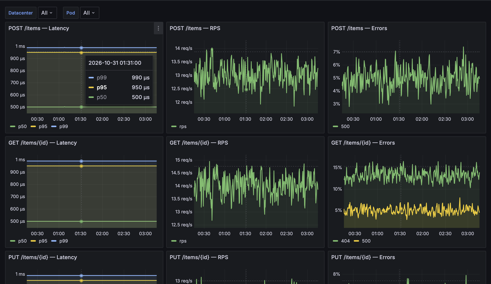

# TASK1 — Инструменты автоматизации в Grafana


По этой схеме `dashboard-generator` автоматически создает дашборд в Grafana.



На дашборде 9 графиков с golden signals для разных ручек. Посмотреть скринкаст разбора можно [на диске](https://drive.google.com/file/d/18Gz18HjPBf8Cu8NAbnIsxbQ0klyTCSt5/view?usp=share_link) или [в репозитории](media/screencast.mp4).

Схематично стенд для этой работы выглядит вот так:


## Как запустить решение

Запустить стенд
```bash
cp .env.example .env
docker compose up -d --build
```

Посмотреть дашборд в браузере
```
http://localhost:3000/login
```

Остановить стенд
```bash
docker compose down -v
```


## Какие порты использовались

| Сервис | Порт | Назначение |
|---|---|---|
| app-msk | 8081 | Первый инстанс приложения |
| app-spb | 8082 | Второй инстанс приложения |
| prometheus | 9090 | Выполняет scrape обоих app |
| grafana | 3000 | Дашборд (логин и пароль `admin` либо в `.env`) |


## Какие метрики и лейблы были выбраны

Две метрики на бизнес-ручки (без `/health`, `/metrics`, `/handlers`):

| Метрика | Тип | Зачем | Лейблы |
|---|---|---|---|
| `http_request_duration_seconds` | Histogram | Latency — p50 / p95 / p99 | `handler` + const `pod_id`, `datacenter` |
| `http_requests_total` | Counter | Throughput (RPS) и Errors | `handler`, `code` + const `pod_id`, `datacenter` |

Два лейбла определяют под и датацентр, один - код ответа и один - тип запроса:

| Лейбл | Откуда | Пример |
|---|---|---|
| `handler` | метод + шаблон пути | `POST /items`, `GET /items/{id}`, `PUT /items/{id}` |
| `code` | HTTP-статус ответа (только у counter) | `200`, `404`, `500` |
| `pod_id` | env `POD_ID` (const label) | `pod-msk-1` |
| `datacenter` | env `DATACENTER` (const label) | `msk`, `spb` |

Как из метрик получаются золотые сигналы
- Latency — `histogram_quantile` поверх `sum by (le)` по бакетам histogram.
- RPS — `sum(rate(http_requests_total{...}[...]))`.
- Errors — тот же counter, фильтр `code=~"4..|5.."`, разбивка `sum by (code)`.

**Почему histogram для latency:** перцентили остаются корректными при агрегации по нескольким подам/ДЦ — складываются бакеты, затем считается квантиль. У Summary квантили считаются на каждом инстансе отдельно и их нельзя корректно суммировать между репликами.


## Приложение на go

Проверить работу приложения:
```bash
curl -sS -X POST http://localhost:8081/items \
  -H 'Content-Type: application/json' \
  -d '{"id":"1","name":"widget"}'

curl -sS http://localhost:8081/items/1

curl -sS -X PUT http://localhost:8081/items/1 \
  -H 'Content-Type: application/json' \
  -d '{"name":"widget-v2"}'
```


## Особенности проекта

Порядок запуска: `Apps` → `Prometheus` → `Grafana` → `Dashboard-generator` → `Load-generator`.

Конфиги Prometheus и Grafana лежат в `configs/` (bind-mount в compose).

Доли ошибок при генерации запросов определяются переменными `ERROR_4XX_RATE` и `FAULT_5XX_RATE` в `.env`

Хранилище приложения сделано через in-memory CRUD. 

Без `POD_ID` и `DATACENTER` процесс не стартует.

Секреты через копирование `.env.example` в `.env`
